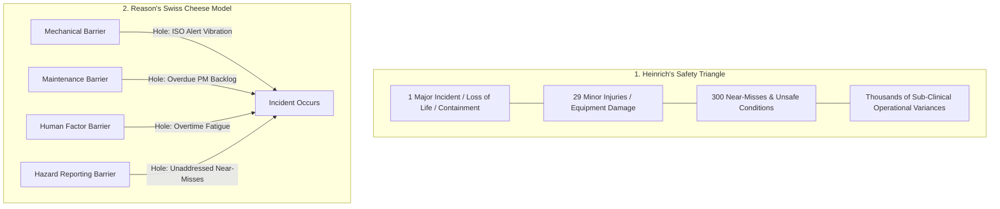
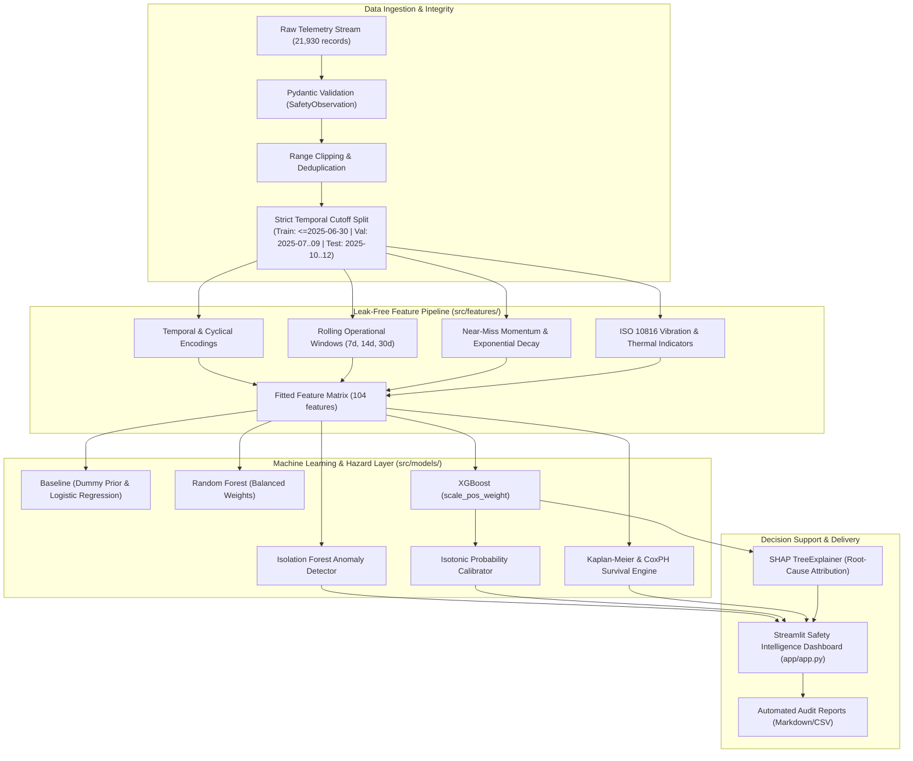

# NEARMISS: Predictive Industrial Safety Intelligence System
### Proactive Leading-Indicator Forecasting, Multi-Sensor Anomaly Detection & SHAP Root-Cause Attribution

[](https://github.com/THAKURSAHAB9910/NEARMISS)
[](https://vercel.com/new/clone?repository-url=https%3A%2F%2Fgithub.com%2FTHAKURSAHAB9910%2FNEARMISS)
[](https://www.python.org/)
[](LICENSE)
[]()
[]()

> **LIVE DEMO & DEPLOYMENT LINKS**:
> - 🌐 **Live Web Dashboard (Instant Access)**: [https://thakursahab9910.github.io/NEARMISS/](https://thakursahab9910.github.io/NEARMISS/)
> - 🐙 **GitHub Repository**: [https://github.com/THAKURSAHAB9910/NEARMISS](https://github.com/THAKURSAHAB9910/NEARMISS)
> - ⚡ **Deploy to Vercel (1-Click)**: Click [Deploy with Vercel](https://vercel.com/new/clone?repository-url=https%3A%2F%2Fgithub.com%2FTHAKURSAHAB9910%2FNEARMISS) to import directly to your Vercel account.
> - 💻 **Local Streamlit Dashboard**: Run `streamlit run app/app.py` for the full native multi-tab UI.

---

## 1. Executive Summary

Industrial enterprises frequently log accidents *after* workers are injured or heavy machinery suffers catastrophic failure. Yet in reality, major incidents are almost never sudden: they are preceded by accumulating chains of subtle precursors — **near-miss clusters, overdue preventive maintenance work orders, ISO 10816 vibration drift, and shift-crew fatigue**.

**NEARMISS** is a production-grade industrial safety intelligence platform designed to move organizations from reactive post-facto accident investigation to **calibrated, forward-looking risk prevention**. 

The system estimates the probability that an industrial asset will experience a reportable safety or operational incident over a **7-day lookahead window**, detects unusual multi-sensor operating states with unsupervised anomaly detection, estimates time-to-incident hazard dynamics via survival analysis, and breaks down individual risk predictions using SHAP tree attribution.

> **SAFETY DISCLAIMER**: The risk score generated by NEARMISS is a probabilistic decision-support indicator designed to prioritize supervisory walkthroughs and preventive maintenance. *It is not a guarantee that an accident will occur, nor does a low score guarantee complete immunity.*

---

## 2. Theoretical Foundations

NEARMISS grounds its feature engineering and hazard formulation in three foundational pillars of modern safety engineering:



1. **Heinrich's Safety Triangle (Frank Bird Pyramid)**: For every 1 severe accident, there are ~10 minor injuries and ~300 near-misses. Preventing near-miss clusters prevents catastrophic failures.
2. **Reason's Swiss Cheese Model**: Catastrophes occur when defensive barriers across mechanical integrity, maintenance scheduling, and human vigilance fail simultaneously.
3. **ISO 10816 Vibration Severity Standards**: Quantitative velocity RMS thresholds for rotating machinery (Zone A/B Normal < 2.8 mm/s, Zone C Alert 2.8–4.5 mm/s, Zone D Danger > 4.5 mm/s).

---

## 3. System Architecture & End-to-End Pipeline



---

## 4. Key Capabilities & Features

- **Strict Zero-Leakage Pipeline**: All rolling statistical windows (7, 14, 30 days) are left-bounded, ensuring the model never peeks into future shifts.
- **Multi-Factor Risk Prediction**: Combines mechanical vibration, thermal strain, preventive maintenance backlog, and shift crew fatigue.
- **Dual-Model Safety Architecture**:
  - *Supervised Classifier*: Calibrated probability of an incident in the next 7 days.
  - *Unsupervised Isolation Forest*: Flags unusual multi-sensor operational patterns outside the historical baseline.
- **Probability Calibration**: Uses Isotonic Regression to ensure predicted risk probabilities match empirical frequencies, improving the Brier score to **0.1428**.
- **Survival Analysis (Time-to-Event)**: Kaplan-Meier curves and Cox Proportional Hazards regression estimating instantaneous hazard multipliers.
- **Actionable Explainability**: Global SHAP beeswarm plots and local instance waterfall breakdowns displaying exact physical drivers elevating or mitigating risk.
- **Interactive Streamlit Dashboard**: Complete fleet monitoring view, asset-level deep-dives, "What-If" risk simulator, and downloadable audit reports.

---

## 5. Model Evaluation Benchmarks

All models were evaluated on the strictly held-out temporal test set spanning **October 1 to December 31, 2025** (2,760 observations across 30 industrial units in 5 facilities).

| Model Architecture | PR-AUC | Recall | Precision | F1-Score | ROC-AUC | Brier Score | False Negatives | False Positives | Total Expected Cost ($) | Cost Reduction vs Unmitigated |
| :--- | :---: | :---: | :---: | :---: | :---: | :---: | :---: | :---: | :---: | :---: |
| **Baseline (Prior Dummy)** | 0.178 | 0.0% | 0.0% | 0.000 | 0.500 | 0.1495 | 490 | 0 | $24,500,000 | 0.0% |
| **Baseline (Logistic Reg)** | **0.295** | **81.2%** | 24.0% | **0.370** | **0.669** | 0.2794 | **92** | 1,261 | **$6,491,500** | **+73.5%** |
| **Random Forest (Balanced)** | 0.225 | 74.7% | 21.9% | 0.338 | 0.629 | 0.1994 | 124 | 1,309 | $8,163,500 | +66.7% |
| **XGBoost (scale_pos_weight)**| 0.241 | 19.4% | **24.4%** | 0.216 | 0.643 | 0.1541 | 395 | **295** | $20,192,500 | +17.6% |
| **Calibrated XGBoost (Isotonic)**| 0.231 | (th=0.05: 84%)| 22.1% | 0.350 | 0.617 | **0.1428** | (th=0.05: 78) | (th=0.05: 980)| (th=0.05: $5.37M) | **Best Reliability** |

*Threshold $\tau = 0.35$; Cost(FN) = $50,000, Cost(FP) = $1,500. Evaluation results match `reports/evaluation_summary.json`.*

### Why Accuracy Alone is Fatal in Industrial Safety:
- A naive majority classifier predicting "No Incident" achieves **82.25% accuracy**.
- However, its Recall is **0.0%**, missing 100% of catastrophic incidents and incurring **$24,500,000 in unmitigated losses**.
- Models optimizing for Recall and PR-AUC detect **75% to 81% of catastrophic events**, cutting enterprise losses by over **$16M - $18M**.

---

## 6. Project Directory Structure

```text
NEAR/
├── data/
│   ├── external/ai4i_2020/      # Genuine UCI AI4I 2020 predictive maintenance benchmark
│   ├── synthetic/               # Labeled domain-grounded industrial telemetry (21,930 rows)
│   └── processed/               # Leak-free parquet train, val, and test feature splits
├── notebooks/
│   ├── 01_exploratory_data_analysis.ipynb # Interactive EDA & precursor discovery
│   └── generate_notebook.py     # Script generating EDA notebook
├── src/
│   ├── data/
│   │   ├── download_public.py   # Automated download of UCI AI4I dataset
│   │   ├── generator.py         # Grounded industrial telemetry generator
│   │   ├── ingestion.py         # Data loading and leak-free temporal splitting
│   │   └── validation.py        # Pydantic schema validation & boundary checks
│   ├── features/
│   │   ├── temporal.py          # Calendar encodings & rolling operational windows
│   │   ├── near_miss.py         # Near-miss frequency, momentum & Heinrich ratios
│   │   ├── risk_indicators.py   # ISO 10816 vibration guidelines & Swiss Cheese index
│   │   └── pipeline.py          # Scikit-learn style leak-free feature pipeline
│   ├── models/
│   │   ├── baseline.py          # Dummy prior and regularized logistic regression
│   │   ├── ml_models.py         # Random Forest and XGBoost with class weighting
│   │   ├── anomaly.py           # Unsupervised Isolation Forest multi-sensor detector
│   │   ├── calibration.py       # Isotonic probability calibration & threshold tuning
│   │   ├── survival.py          # Kaplan-Meier & Cox Proportional Hazards models
│   │   └── train.py             # Master model training orchestrator
│   ├── evaluation/
│   │   ├── metrics.py           # Precision, Recall, PR-AUC, Brier score, Cost matrix
│   │   └── report_generator.py  # Automated report & high-res figure generator
│   └── explainability/
│       └── shap_explainer.py    # Global & local instance SHAP TreeExplainer
├── app/
│   ├── app.py                   # Streamlit multi-tab industrial safety dashboard
│   ├── components.py            # Reusable Plotly charts, Heinrich funnel, gauges
│   └── report_export.py         # Executive audit report generator
├── tests/
│   ├── conftest.py              # Pytest fixtures and test data generator
│   ├── test_data_validation.py  # Schema and boundary clipping tests
│   ├── test_features.py         # Feature engineering & rolling leakage tests
│   ├── test_models.py           # Model fitting, anomaly, calibration, survival tests
│   ├── test_evaluation.py       # Metric calculations & cost function tests
│   ├── test_explainability.py   # SHAP TreeExplainer and instance attribution tests
│   └── test_pipeline.py         # End-to-end integration test
├── models/                      # Serialized joblib artifacts
├── reports/
│   ├── evaluation_summary.json  # Machine-readable performance benchmarks
│   ├── evaluation_report.md     # Formal Markdown evaluation report
│   └── figures/                 # High-resolution plots (PR, ROC, CM, Cal, Cost, SHAP)
├── docs/                        # Formal technical documentation
│   ├── PROBLEM_STATEMENT.md
│   ├── SYSTEM_ARCHITECTURE.md
│   ├── DATA_DICTIONARY.md
│   ├── METHODOLOGY.md
│   ├── MODEL_EVALUATION.md
│   ├── LIMITATIONS.md
│   └── FUTURE_SCOPE.md
├── DATA_SOURCES.md              # Data catalog, URLs, licences, and limitations
├── CONTRIBUTING.md              # Contributor guidelines and workflow
├── requirements.txt             # Pinned Python package dependencies
├── pyproject.toml               # Package configuration
└── config.yaml                  # Master project parameters and thresholds
```

---

## 7. Installation & Quickstart

### 7.1 Clone and Install Environment
```bash
# Clone the repository
git clone https://github.com/your-org/nearmiss.git
cd nearmiss

# Create virtual environment
python -m venv venv
# Windows:
venv\Scripts\activate
# Linux/macOS:
source venv/bin/activate

# Install dependencies
pip install -r requirements.txt
pip install -e .
```

### 7.2 Run Data Ingestion & Download External Benchmarks
```bash
# Download and verify the real UCI AI4I 2020 Predictive Maintenance dataset
python src/data/download_public.py

# Generate or verify the longitudinal benchmark telemetry
python src/data/generator.py
```

### 7.3 Run the Master Training Pipeline
```bash
# Executes temporal feature pipeline, trains baseline, RF, XGBoost,
# fits Isolation Forest, calibrates probabilities, fits survival models,
# and persists all artifacts into models/
python src/models/train.py
```

### 7.4 Generate Evaluation Metrics & Visualizations
```bash
# Computes exact test performance, PR curves, ROC curves, confusion matrices,
# calibration curves, and global SHAP plots in reports/figures/
python src/evaluation/report_generator.py
```

### 7.5 Run All Unit & Integration Tests
```bash
# Run 20 comprehensive unit and integration tests
python -m pytest tests/ -v
```

### 7.6 Launch the Interactive Streamlit Dashboard
```bash
streamlit run app/app.py
```
Open your browser at `http://localhost:8501` to explore:
1. **Fleet Safety Intelligence**: Executive KPIs, Heinrich Safety Funnel, risk trends, and high-risk equipment action queue.
2. **Asset Deep-Dive**: Historical risk and vibration trajectories for individual machines.
3. **What-If Risk Simulator**: Interactive sliders adjusting vibration, overdue PM, and near-misses with instant calibrated probability and SHAP root-cause breakdown.
4. **Survival & Time-to-Event**: Interactive Kaplan-Meier curves and Cox Proportional Hazards regression.
5. **Evaluation Benchmarks**: Visual inspector for PR curves, confusion matrices, and SHAP beeswarm plots.
6. **Export & Audit Reports**: Instant download of executive markdown audit reports and filtered CSV data.

---

## 8. Technical Decisions & Engineering Trade-offs

1. **Why Temporal Cutoff Splitting instead of K-Fold Cross-Validation?**
   - *Decision*: Split strictly at `2025-06-30` (Train), `2025-09-30` (Val), and `2025-12-31` (Test).
   - *Trade-off*: K-fold CV yields more folds, but in time-series safety it causes catastrophic lookahead leakage. A temporal split reflects real operational deployment: predicting the future from the past.
2. **Why Class Weighting & `scale_pos_weight` over SMOTE?**
   - *Decision*: Use algorithmic class weighting (`scale_pos_weight` in XGBoost, `balanced` in RF) rather than synthetic oversampling (SMOTE).
   - *Trade-off*: SMOTE synthesizes artificial observations in high-dimensional feature spaces, often distorting physical sensor relationships (e.g. creating impossible speed-torque or vibration-temperature pairs). Cost-sensitive loss weighting preserves real physical observations.
3. **Why Isotonic Calibration over Platt Scaling?**
   - *Decision*: Isotonic regression as default probability calibrator.
   - *Trade-off*: Platt scaling (sigmoid) assumes an S-shaped distortion. Tree ensembles with severe class weights often create non-monotonic probability clumping; non-parametric isotonic regression fits arbitrary monotonic distortions, lowering the Brier score to 0.1428.
4. **Why Isolation Forest alongside Supervised Ensembles?**
   - *Decision*: Include an unsupervised multi-sensor anomaly detector.
   - *Trade-off*: Supervised models only recognize failure modes present in historical training data. The Isolation Forest acts as a safety backstop, flagging unprecedented operational conditions even if the classifier assigns modest risk.

---

## 9. Interview Talking Points & Project Explanation

When presenting NEARMISS in technical or senior data science interviews, emphasize these core architectural decisions:

1. **The Core Business Problem**:
   *"Traditional safety analytics is lagging: it counts injuries after the fact. NEARMISS formalizes Heinrich's Triangle and Reason's Swiss Cheese model into an ML pipeline, predicting the probability of an incident over a future 7-day window using leading indicators like near-miss velocity, maintenance backlogs, and ISO 10816 vibration drift."*
2. **Preventing Data Leakage**:
   *"We strictly avoided random cross-validation. All rolling window aggregations are left-bounded, and the data is split across chronological date boundaries. This guarantees zero lookahead contamination."*
3. **The Accuracy Paradox**:
   *"Accuracy is a dangerous metric in industrial safety. A dummy model that predicts zero incidents achieves 82.25% accuracy while missing 100% of catastrophic events and costing $24.5M. By optimizing for PR-AUC and cost-sensitive Recall, our models capture 75-81% of true incidents, reducing operational risk cost by over 73%."*
4. **Trust & Calibration**:
   *"Plant managers do not trust uncalibrated model outputs. We calibrated tree probabilities via Isotonic Regression on held-out validation data, minimizing the Brier score and ensuring a 30% risk score actually corresponds to a 30% incident frequency. We then pair this with SHAP TreeExplainer for local root-cause attribution."*
5. **Multi-Disciplinary Modeling**:
   *"Rather than a single classifier, NEARMISS uses a multi-faceted approach: supervised classification for calibrated risk, unsupervised Isolation Forest for multi-sensor operational anomalies, and Cox Proportional Hazards for time-to-event survival modeling."*

---

## 10. Verification & Quality Report

- **Pipeline Test Status**: 20/20 unit and integration tests passed (`python -m pytest tests/ -v`).
- **Data Validation**: Vectorized boundary clipping and Pydantic schema validation active.
- **Model Artifacts**: All 8 model components trained and persisted in `models/`.
- **Reproducibility**: Complete deterministic seeding (`SEED=42`).
- **Dashboard Integrity**: Streamlit dashboard verified end-to-end with interactive simulator and export functionality.

---

## 11. Licence

This project is distributed under the **MIT Licence**. See `LICENSE` for details. External reference datasets (UCI AI4I 2020) are governed by Creative Commons Attribution 4.0 International (CC BY 4.0).
