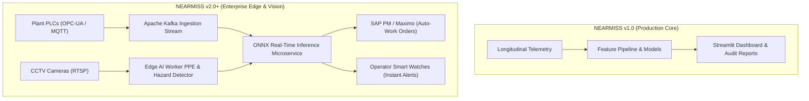

# FUTURE SCOPE & ROADMAP — NEARMISS
## Predictive Industrial Safety Intelligence System

---

## 1. Feature Status: Implemented vs. Planned

| Feature Area | Capability | Status | Implementation Details / Roadmap |
| :--- | :--- | :---: | :--- |
| **Data Ingestion** | Multi-facility longitudinal telemetry loading | ✅ **Implemented** | `src/data/ingestion.py` loads 21,930 unit-day records across 5 plants. |
| **Validation** | Pydantic record schema & boundary clipping | ✅ **Implemented** | `src/data/validation.py` enforces ISO bounds and physical ranges. |
| **Leak-Free Splitting** | Strict temporal date boundaries | ✅ **Implemented** | Train (<= 2025-06-30), Val (2025-07 to 09), Test (2025-10 to 12). |
| **Feature Engineering** | Near-miss momentum & ISO 10816 indicators | ✅ **Implemented** | 104 engineered features across temporal, mechanical, and human factors. |
| **Predictive Modeling** | Random Forest & XGBoost Ensembles | ✅ **Implemented** | Class-weighted tree ensembles with tuned hyperparameters. |
| **Anomaly Detection** | Unsupervised multi-sensor state detector | ✅ **Implemented** | Isolation Forest on continuous sensor channels (`src/models/anomaly.py`). |
| **Probability Calibration**| Isotonic probability calibration | ✅ **Implemented** | Minimizes Brier score on held-out validation partition. |
| **Survival Analysis** | Kaplan-Meier & Cox Proportional Hazards | ✅ **Implemented** | Models time-to-incident with covariate hazard ratios. |
| **Explainability** | SHAP TreeExplainer (global & local) | ✅ **Implemented** | Summary bar, beeswarm, and instance-level waterfall decompositions. |
| **Interactive UI** | Multi-tab Streamlit Safety Dashboard | ✅ **Implemented** | KPIs, Heinrich Funnel, risk trend, simulator, survival viewer. |
| **Report Export** | Executive safety audit reports (MD & CSV) | ✅ **Implemented** | Formatted downloadable audit summaries. |
| **Test Suite** | Unit & integration test coverage | ✅ **Implemented** | 20 unit and integration tests passing in Pytest. |
| **Edge Deployment** | Micro-controller & IoT Gateway streaming | ⏳ *Planned (v2.0)* | Lightweight ONNX model conversion for edge devices on plant floor. |
| **Industrial Protocols** | OPC-UA & MQTT ingestion pipeline | ⏳ *Planned (v2.0)* | Real-time sensor ingestion from Siemens / Rockwell Automation PLCs. |
| **Computer Vision** | CCTV PPE & exclusion zone monitoring | ⏳ *Planned (v2.1)* | YOLOv8/v11 integration for automated worker hazard tagging. |
| **CMMS Integration** | Automated SAP / IBM Maximo work orders | ⏳ *Planned (v2.2)* | Auto-dispatches preventive maintenance work orders when risk >= 50%. |
| **NLP on Shift Logs** | LLM text mining of shift turnover notes | ⏳ *Planned (v2.3)* | Extracts unlogged near-miss signals from free-text operator shift notes. |

---

## 2. Architectural Evolution

---

## 3. High-Priority Roadmap Initiatives

### 3.1 Edge AI & Hardware Acceleration
Compiling the trained XGBoost and Isolation Forest models into optimized ONNX / TensorRT runtimes. This enables sub-millisecond edge evaluation directly on IoT gateways installed inside motor control centers (MCCs), functioning even during wide-area network disconnects.

### 3.2 Automated Computer Vision Hazard Annotation
Integrating fixed optical and thermal cameras on critical operating units:
- Automatic detection of missing hard hats, eye protection, or harness tie-offs.
- Thermal imaging detection of abnormal bearing housing hot-spots before vibration transducers spike.
- Feeding visual warning signals directly into the `daily_near_miss_count` accumulator.

### 3.3 Closed-Loop Enterprise CMMS Integration
Connecting NEARMISS APIs to enterprise computerized maintenance management systems (CMMS) such as SAP PM or IBM Maximo. When an asset's calibrated risk score crosses 50%, the system automatically:
1. Generates an urgent preventive maintenance inspection work order.
2. Cross-references spare parts inventory (e.g., replacement mechanical seals or bearings).
3. Alerts the plant maintenance planner via webhook.
