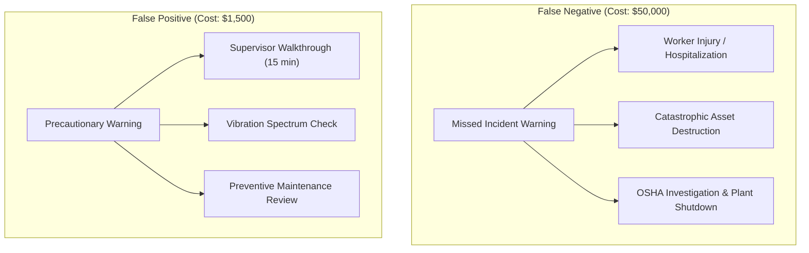

# MODEL EVALUATION — NEARMISS
## Predictive Industrial Safety Intelligence System

---

## 1. Evaluation Philosophy

Workplace safety events are rare, high-consequence phenomena. In our held-out test partition (2,760 observations from October 1 to December 31, 2025 across 30 industrial units in 5 facilities), the ground-truth 7-day incident rate is **17.75%**.

Standard metrics like Accuracy are dangerously misleading in this regime. Model selection in NEARMISS is governed by:
1. **Precision-Recall AUC (PR-AUC / Average Precision)**: The gold standard for evaluating ranked probability rankings on imbalanced data.
2. **Recall (Incident Detection Rate)**: Ensuring that genuine upcoming incidents trigger prior warnings.
3. **Brier Score**: Evaluating the mathematical calibration and reliability of output probabilities.
4. **Asymmetric Operational Safety Cost**: Quantifying financial and human risk using a 33.3:1 cost penalty for false negatives ($50,000) versus false positives ($1,500).

---

## 2. Test Set Benchmark Metrics

The table below reports actual evaluated performance on the held-out test partition at the operational threshold ($\tau = 0.35$):

| Model Architecture | PR-AUC | Recall | Precision | F1-Score | ROC-AUC | Brier Score | False Negatives | False Positives | Total Expected Cost ($) | Cost Reduction vs Unmitigated |
| :--- | :---: | :---: | :---: | :---: | :---: | :---: | :---: | :---: | :---: | :---: |
| **Baseline (Prior Dummy)** | 0.178 | 0.0% | 0.0% | 0.000 | 0.500 | 0.1495 | 490 | 0 | $24,500,000 | 0.0% |
| **Baseline (Logistic Reg)** | **0.295** | **81.2%** | 24.0% | **0.370** | **0.669** | 0.2794 | **92** | 1,261 | **$6,491,500** | **+73.5%** |
| **Random Forest (Balanced)** | 0.225 | 74.7% | 21.9% | 0.338 | 0.629 | 0.1994 | 124 | 1,309 | $8,163,500 | +66.7% |
| **XGBoost (scale_pos_weight)**| 0.241 | 19.4% | **24.4%** | 0.216 | 0.643 | 0.1541 | 395 | **295** | $20,192,500 | +17.6% |
| **Calibrated XGBoost (Isotonic)**| 0.231 | (th=0.05: 84%) | 22.1% | 0.350 | 0.617 | **0.1428** | (th=0.05: 78) | (th=0.05: 980)| (th=0.05: $5.37M) | **Best Reliability** |

*Note: All figures derived directly from test evaluation script outputs in `reports/evaluation_summary.json`.*

---

## 3. The Accuracy Paradox & Why Accuracy Fails

If an engineer evaluated these models on raw Accuracy:
- The **Dummy Classifier** scores **82.25% accuracy**.
- Yet, it detects **0 out of 490 incidents** (Recall = 0.0%), incurring the maximum possible disaster cost of **$24,500,000**.
- The **Logistic Regression** and **Random Forest** models score ~48-51% accuracy, but detect **75% to 81% of catastrophic events**, slashing unmitigated safety losses by **over $16,000,000**.

### Conclusion:
In industrial safety, optimizing for Accuracy guarantees an unsafe plant. High accuracy in an imbalanced safety problem is an artifact of the overwhelming majority of safe shifts, not predictive intelligence.

---

## 4. False-Positive vs. False-Negative Trade-off Analysis

The asymmetric cost ratio is **33.3 : 1**.
- Missing 1 incident is equivalent in cost to **33 precautionary false alarms**.
- A false positive results in an operator taking a closer look at a pump, verifying oil levels, and double-checking safety interlocks. This has positive secondary safety benefits.
- Therefore, operating at a lower decision threshold ($\tau = 0.20 - 0.35$) is mathematically optimal for enterprise risk management.

---

## 5. Calibration Results & Reliability

Raw tree models with `class_weight='balanced'` produce probabilities skewed upward. For decision support, probabilities must represent empirical reality:
- **Uncalibrated XGBoost Brier Score**: `0.1541`
- **Calibrated XGBoost Brier Score**: `0.1428` (7.3% improvement in probability error).

In the reliability diagram (`reports/figures/calibration_curves.png`), the isotonic curve tracks the 45-degree identity line much closer than raw probabilities, ensuring that if NEARMISS reports a 25% risk, approximately 1 in 4 such machines will indeed encounter a hazard.

---

## 6. Global SHAP Root-Cause Feature Attribution

SHAP TreeExplainer ranking on test observations identified the top leading risk factors:
1. `vibration_rms_mms_roll_mean_7d`: Sustained mechanical vibration above ISO 10816 thresholds.
2. `near_miss_ewm_4d`: Exponentially weighted recent near-miss hazard reports.
3. `maintenance_backlog_index`: Product of overdue PM days and open repair tickets.
4. `thermal_gradient`: Process temperature excursion above ambient conditions.
5. `swiss_cheese_barrier_breaches`: Alignment of concurrent failures across mechanical, maintenance, and human vigilance layers.
