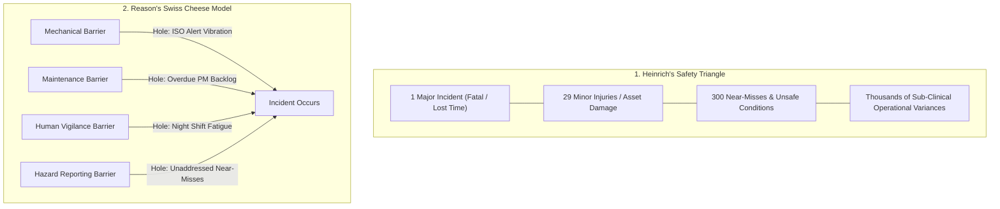

# PROBLEM STATEMENT — NEARMISS
## Predictive Industrial Safety Intelligence System

---

## 1. Industry Context & The Core Problem

Industrial facilities — including petrochemical refineries, heavy manufacturing plants, power generation stations, mining operations, and automated logistics hubs — operate under strict occupational safety and asset integrity standards.

Despite substantial investment in personal protective equipment (PPE) and regulatory reporting (e.g., OSHA, MSHA, HSE), organizations remain predominantly **reactive**. Safety intervention is typically triggered *after* a catastrophic incident occurs:
- A severe injury or fatality.
- A critical pressure vessel rupture or chemical release.
- A multi-million-dollar catastrophic machine failure causing extended plant shutdowns.

### The Warning Signal Paradox
Traditional incident registries treat catastrophic accidents as sudden, stochastic events. In reality, modern safety science demonstrates that **major incidents are rarely sudden**. They are almost invariably preceded by an accumulation of weak leading signals:
1. **Repeated Near-Misses & Unsafe Conditions**: Small slips, trips, guard trips, momentary pressure excursions, or chemical vapor weeping that were caught just in time or dismissed as inconsequential.
2. **Preventive Maintenance (PM) Backlog**: Routine servicing, bearing lubrication, and seal replacements delayed by operational production pressures.
3. **Mechanical & Thermal Degradation**: Gradual upward drift in vibration velocity RMS, elevated vibration kurtosis (bearing impact shocks), and thermal dissipation degradation.
4. **Human Factors & Circadian Fatigue**: Night shift rotations, extended cumulative overtime, and crew fatigue degrading situational vigilance.

---

## 2. Theoretical Frameworks

The NEARMISS system is theoretically anchored in three established foundational paradigms of safety engineering:

### 2.1 Heinrich's Safety Triangle & Frank Bird's Pyramid
H.W. Heinrich (1931) and Frank E. Bird (1966) analyzed hundreds of thousands of industrial mishaps. Their empirical findings established that for every **1 major lost-time injury**, there are approximately **10 to 30 minor injuries**, **300 near-miss incidents**, and thousands of operational micro-irregularities. 

*The Core Insight*: Preventing the bottom of the pyramid (near-miss clusters and sub-clinical operating irregularities) directly prevents the apex catastrophe.

### 2.2 Reason's Swiss Cheese Model
James Reason (1990) demonstrated that catastrophic failures in complex sociotechnical systems occur when latent weaknesses across multiple defensive layers align:
- Mechanical integrity (vibration / thermal stress)
- Maintenance management (overdue PM work orders)
- Environmental operating conditions (ambient temperature extremes)
- Organizational & human vigilance (overtime fatigue, shift rotation)

When an equipment unit operates with elevated vibration (ISO 10816 Alert), overdue maintenance (> 14 days), unaddressed near-misses (>= 2 in 7 days), and night-shift fatigue, multiple defense barriers fail simultaneously.

### 2.3 ISO 10816 Mechanical Vibration Severity Guidelines
International Standard ISO 10816 defines vibration velocity RMS severity zones for industrial rotating machinery:
- **Zone A/B (Nominal / Unrestricted)**: Vibration RMS < 2.8 mm/s.
- **Zone C (Alert / Restricted Operation)**: 2.8 mm/s <= Vibration RMS < 4.5 mm/s (action required to prevent long-term damage).
- **Zone D (Danger / Critical)**: Vibration RMS >= 4.5 mm/s (immediate damage or catastrophic failure imminent).

---

## 3. Objective of NEARMISS

The objective of **NEARMISS** is to synthesize multi-stream operational sensor telemetry, maintenance work order logs, and human-shift factors to answer one critical forward-looking question:

> **"What is the calibrated probability that this industrial asset will experience a reportable safety or operational incident within the next 7 days?"**

Crucially, NEARMISS:
- Is **not a generic classifier**: It explicitly extracts temporal near-miss momentum, exponential decay warning intensity, and multi-barrier failure combinations.
- Implements **zero temporal data leakage**: Training, validation, and test datasets are strictly separated by date boundaries, and all rolling indicators use only historical information.
- Employs **calibrated probability outputs**: Ensures predicted risk scores reflect real-world empirical incident rates for trustworthy decision support.
- Delivers **actionable root-cause explainability (SHAP)**: Enables plant safety superintendents and maintenance managers to understand the exact physical and operational factors elevating risk before an incident occurs.
