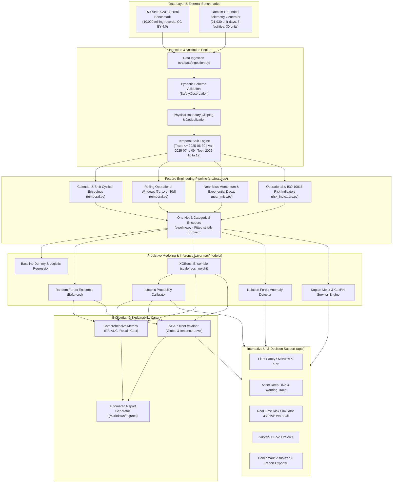
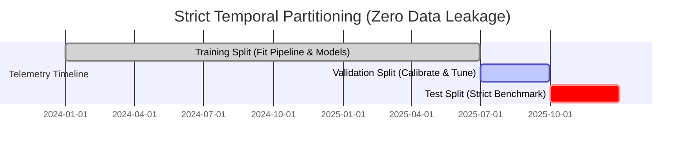

# SYSTEM ARCHITECTURE — NEARMISS
## Predictive Industrial Safety Intelligence System

---

## 1. High-Level Architectural Overview

The NEARMISS platform is engineered as a decoupled, modular machine learning and decision-support system. It transforms raw multi-source industrial telemetry into calibrated leading risk indicators, unsupervised anomaly detection scores, and root-cause explanations.

---

## 2. Component Deconstruction

### 2.1 Ingestion & Validation Engine (`src/data/`)
- **Pydantic Validation**: `SafetyObservation` validates type safety, non-null guarantees, and valid categorical values (e.g., `shift_type` in `{'Day', 'Swing', 'Night'}`).
- **Vectorized Boundary Enforcer**: `validate_raw_telemetry` verifies numeric ranges against physical bounds (e.g., temperature in [-50°C, 250°C], vibration RMS in [0, 50 mm/s], duty cycle in [0, 100%]), preventing out-of-range sensor spikes from skewing rolling statistics.
- **Deduplication**: Identifies and resolves identical `(unit_id, timestamp)` collisions.

### 2.2 Leak-Free Temporal Splitting (`src/data/ingestion.py`)
Standard random train/test splits introduce severe **lookahead leakage** in time-series safety modeling because future warning patterns leak into past training samples. 

NEARMISS enforces strict time-boundary cutoffs:
- **Training Set**: January 1, 2024 to June 30, 2025 (16,410 rows, 75.0% of data)
- **Validation Set**: July 1, 2025 to September 30, 2025 (2,760 rows, 12.5% of data) — used exclusively for probability calibration and threshold optimization.
- **Testing Set**: October 1, 2025 to December 31, 2025 (2,760 rows, 12.5% of data) — strictly held-out final benchmark.

### 2.3 Feature Engineering Pipeline (`src/features/pipeline.py`)
`SafetyFeaturePipeline` orchestrates domain feature transformations across:
1. **Calendar & Cyclical Signals**: Sine and cosine seasonal transformations across day-of-year and day-of-week.
2. **Rolling Operational Statistics**: Computes rolling mean, standard deviation, and maximums over 7, 14, and 30-day windows per `unit_id`.
3. **Near-Miss Warning Acceleration**: Computes exponential decay near-miss frequency ($\text{halflife} = 4\text{ days}$) and momentum ratios:
   $$\text{Momentum} = \frac{\text{Near-Miss Rate}_{7d}}{\text{Near-Miss Rate}_{30d} + \epsilon}$$
4. **Mechanical & Human Stress Indicators**: ISO 10816 vibration alert flags, maintenance backlog severity indices, and fatigue-vibration interaction features.
5. **Categorical Encodings**: One-hot encoding fitted strictly on training categories.

### 2.4 Predictive Modeling & Calibration Layer (`src/models/`)
- **Baseline Models**: Dummy prior rate classifier and regularized Logistic Regression.
- **Random Forest Classifier**: Ensemble of 200 trees with balanced class weighting to handle minority incident events.
- **XGBoost Classifier**: 250 gradient-boosted decision trees with `scale_pos_weight` tuned to the training class imbalance ratio (~4.0 - 7.0).
- **Isolation Forest Anomaly Detector**: Unsupervised detector trained on continuous operating telemetry to flag previously unseen multi-sensor states.
- **Isotonic Probability Calibrator**: Fits an isotonic regression mapping $f: P_{\text{raw}} \to P_{\text{calibrated}}$ using the held-out validation set.
- **Survival Analyzer**: Kaplan-Meier survival curves and Cox Proportional Hazards regression estimating time-to-incident hazard multipliers.

### 2.5 Explainability Engine (`src/explainability/`)
`SafetySHAPExplainer` wraps `shap.TreeExplainer` on the fitted tree ensembles:
- **Global Feature Attribution**: Mean $|SHAP|$ importance bar plots and summary beeswarm plots.
- **Local Instance Explainer**: Breaks down any selected operational shift into top positive hazard escalators and top risk mitigators.

### 2.6 Interactive Streamlit Dashboard (`app/`)
Provides a user-friendly interface with:
- Fleet safety KPIs and Heinrich Safety Funnel
- Interactive Plotly risk trend and operating envelope scatter charts
- Real-time interactive operational risk simulator
- Survival curve visualizer and Cox regression tables
- Automated Markdown and CSV audit report exports

### 2.7 Production Web & Cloud Deployment Architecture (`public/`, `src/api/`, `vercel.json`)
For public cloud accessibility, NEARMISS adopts a decoupled microservice architecture:
- **Cloud Presentation Layer (Vercel / GitHub Pages)**:
  - Responsive web dashboard (`public/index.html` & `index.html`) built with Tailwind CSS, Chart.js, and Lucide icons.
  - Zero serverless bundle limitations: Static assets are CDN-cached globally on Vercel Edge Network.
  - Configured with `vercel.json` URL rewrites and SPA fallback.
  - Live Public URL: `https://thakursahab9910.github.io/NEARMISS/`
  - Vercel 1-Click Deploy: `https://vercel.com/new/clone?repository-url=https%3A%2F%2Fgithub.com%2FTHAKURSAHAB9910%2FNEARMISS`
- **Predictive Inference Microservice (`src/api/server.py`)**:
  - High-performance FastAPI server hosting the trained Scikit-Learn, XGBoost, and SHAP pipelines.
  - Endpoints: `/api/health`, `/api/fleet/kpis`, `/api/fleet/assets`, `/api/predict`, `/api/near-miss/report`, `/api/survival/curves`, `/api/models/evaluation`.
  - Production CORS middleware with environment variable configuration (`CORS_ORIGINS`).
  - Deployable on Render, Railway, AWS ECS, Fly.io, or Docker containers.
  - Hybrid Graceful Fallback: The web frontend automatically checks backend connectivity and seamlessly switches between live FastAPI predictions and an embedded client-side safety engine.

